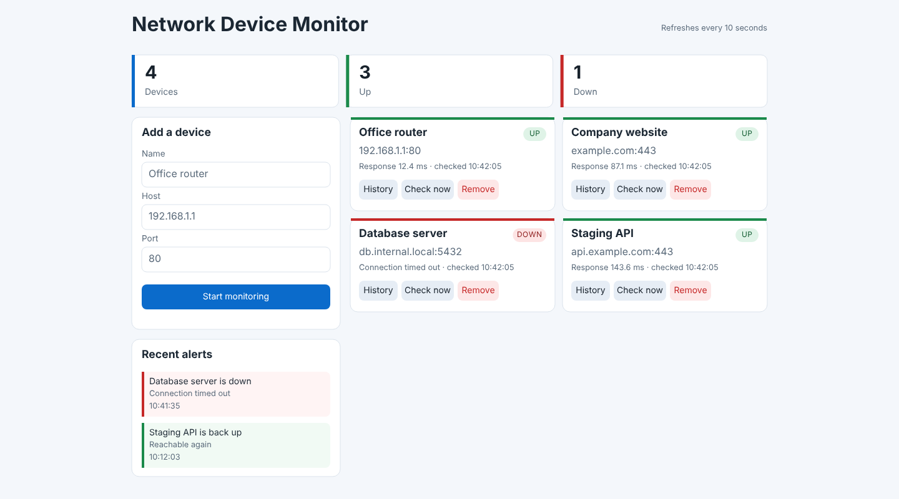
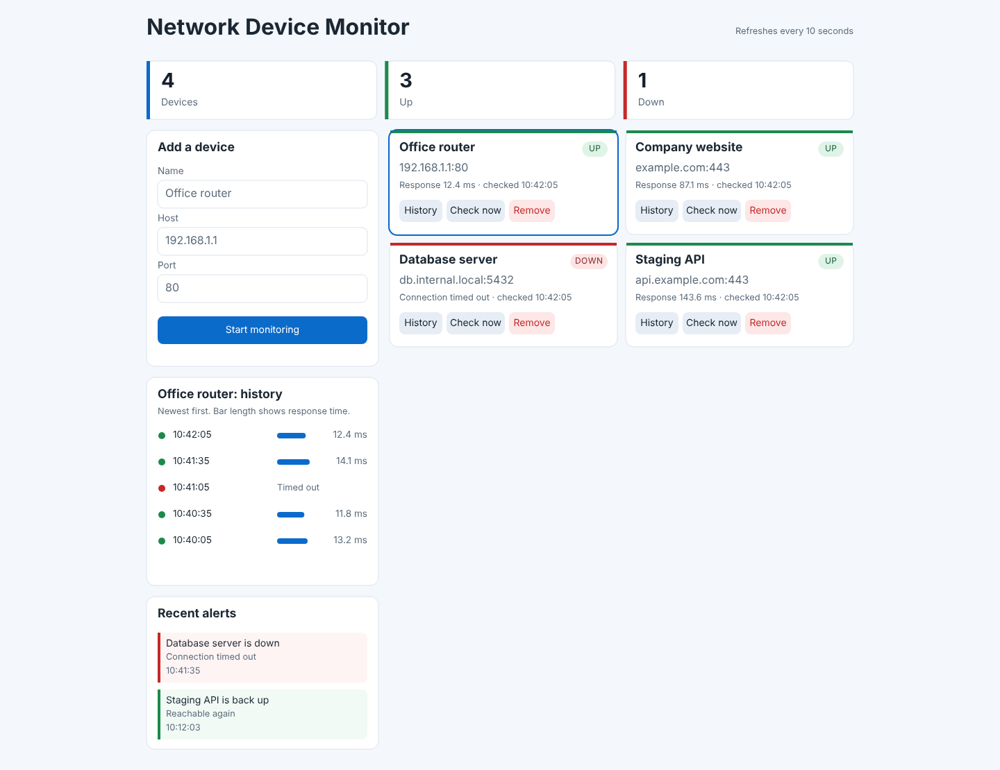
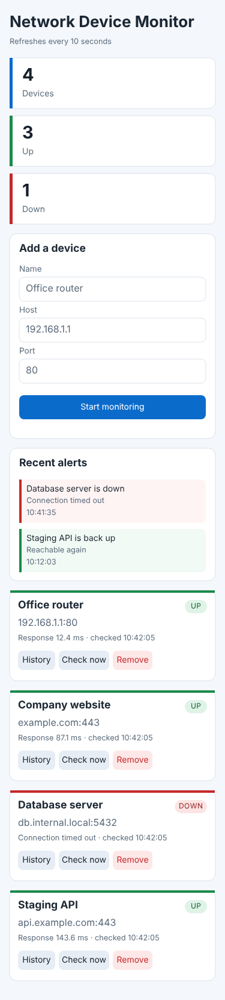
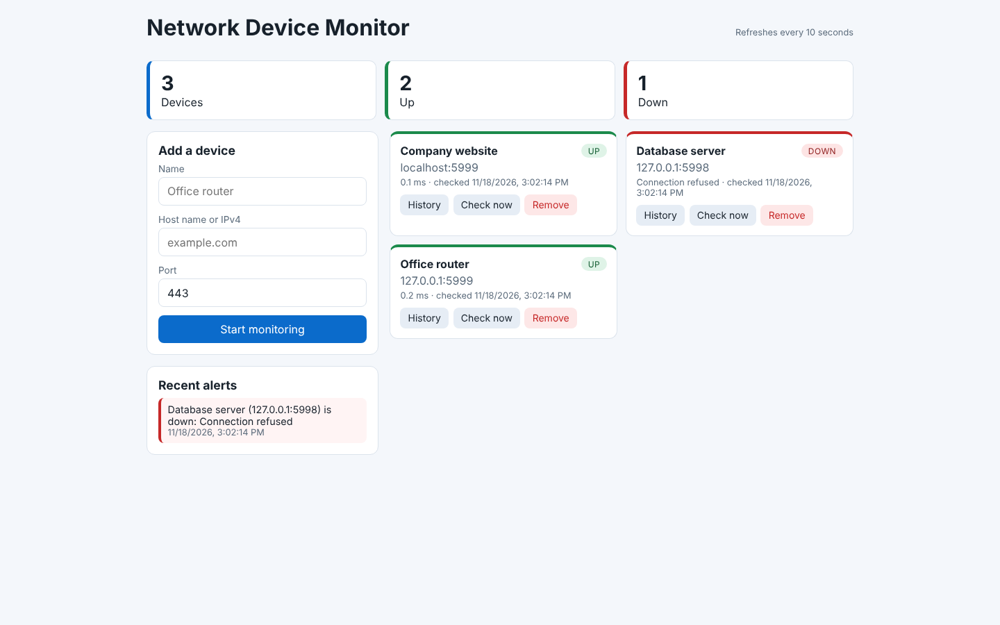

# Network Device Monitor


[](FIGMA_LINK_HERE)
[](ADD_DEMO_LINK_HERE)

> 🎨 **Designed in Figma first, then built to match the mockup** at desktop (1440 px) and mobile (375 px) widths, checked in Figma Dev Mode.


A dashboard that checks whether devices or websites are reachable. You add a host and port; a background job checks each one every 30 seconds, stores the results in SQL, shows live up/down status and response times, and raises an alert when a device goes down or recovers.

**Stack:** React (JavaScript) front end, Flask REST API, SQLite (SQL) database, Python `unittest` tests.

## Run it

```bash
cd backend
pip install -r requirements.txt
python app.py
```

Open http://localhost:5001. Add a device such as `example.com` on port `443` and watch it appear. The React files load from a CDN, so you need internet access the first time the page loads.

Change how often checks run: `CHECK_INTERVAL=10 python app.py` (seconds).

## Run the tests

```bash
cd backend
python -m unittest -v
```

The tests start a real local TCP server to check an "up" device and use a closed port for a "down" device, so they need no internet.

## How it works

1. `POST /api/devices` validates the input, saves the device, and runs a first check straight away.
2. A background thread loops through every device, tries a TCP connection (2 second timeout), and saves the result with the response time.
3. If the result differs from the previous check, an alert is saved ("down" or "recovered").
4. The dashboard polls the API every 10 seconds and redraws.

TCP checks are used instead of ICMP ping because ping needs administrator rights.

## Secure coding and reliability

| Concern | What the code does |
| --- | --- |
| Input validation | Host must be a valid host name or IPv4; port 1 to 65535; name 1 to 60 characters; limit of 50 devices |
| SQL injection | Every query is parameterised |
| Duplicates | A host and port pair can only be added once (SQL `UNIQUE` constraint) |
| Resource limits | 2 second timeout per check; only the newest 500 checks per device are kept |
| Reliability | The monitor thread catches and logs errors, so one bad cycle does not stop monitoring |
| XSS | React escapes all rendered text |
| Headers | `X-Content-Type-Options`, `X-Frame-Options`, `Referrer-Policy`; API responses are `no-store` |
| SSRF | With `BLOCK_PRIVATE_HOSTS=1` (set for the public demo), private, loopback and link-local addresses are refused when adding a device and when checking it. The name is resolved once and the connection goes to that exact address, so a DNS answer that changes between the check and the connection (DNS rebinding) cannot bypass the guard |

**Security note:** the app opens connections to whatever host a user enters. It has no login, so run it locally or add authentication before exposing it to a network.

## API

| Method and path | Purpose |
| --- | --- |
| `GET /api/devices` | All devices with their latest status |
| `POST /api/devices` | Add a device (`name`, `host`, `port`) |
| `DELETE /api/devices/<id>` | Stop monitoring a device |
| `POST /api/devices/<id>/check` | Run a check now |
| `GET /api/devices/<id>/history?limit=50` | Recent checks, newest first |
| `GET /api/summary` | Counts of total, up, down and unknown devices |
| `GET /api/alerts` | The 30 most recent alerts |

## Design (Figma)

The full design brief (screens, components, colour and text styles, spacing) is in [`docs/FIGMA_DESIGN_SPEC.md`](docs/FIGMA_DESIGN_SPEC.md). The UI was built to match the Figma mockup at 1440 px and 375 px.

**[Open the Figma design](FIGMA_LINK_HERE)**

How I built it to match the mockup:

- Defined colour, text and spacing styles in Figma and mirrored them as CSS variables in `styles.css`
- Read exact spacing, sizes and colours in Dev Mode
- Compared the Figma frame and the running app side by side at 1440 px and 375 px, then fixed every difference

### Screens

**Dashboard (desktop)**



**Device selected with history (desktop)**



**Dashboard (mobile, 375 px)**



Source files (SVG, importable into Figma) are in [`docs/design/`](docs/design/).

After building: side-by-side check of the design and the running app.

| Design | Finished app |
| --- | --- |
|  |  |

## Project plan (agile)

Tasks with acceptance criteria are in [`docs/AGILE_BOARD.md`](docs/AGILE_BOARD.md). Run `bash scripts/create_issues.sh` to create them as GitHub Issues, track them on a GitHub Projects board, and commit in small steps:

- [ ] Database schema and device endpoints with validation
- [ ] TCP check function and unit tests
- [ ] Background monitor and alerts on state change
- [ ] React dashboard: summary, add form, device cards
- [ ] History panel and alerts list
- [ ] Match the UI to the Figma design
- [ ] Deploy a demo and add its link here

## Deploy

- **Render (easiest):** push to GitHub, then Render > New > Blueprint > choose the repo. `render.yaml` does the rest.
- **Docker:** `docker build -t network-device-monitor . && docker run -p 5001:5001 network-device-monitor`
- On the free plan the database resets when the service restarts. That is fine for a demo.

## Documentation

- [Technical design](docs/TECHNICAL_DESIGN.md): architecture, data model, security decisions, trade-offs
- [User guide](docs/USER_GUIDE.md): how to use the app
- [Figma design spec](docs/FIGMA_DESIGN_SPEC.md) and [agile board](docs/AGILE_BOARD.md)

## Ideas to extend it

- Email or Slack notification when a device goes down
- A line chart of response times
- Login and per-user device lists
- HTTP status checks in addition to TCP
